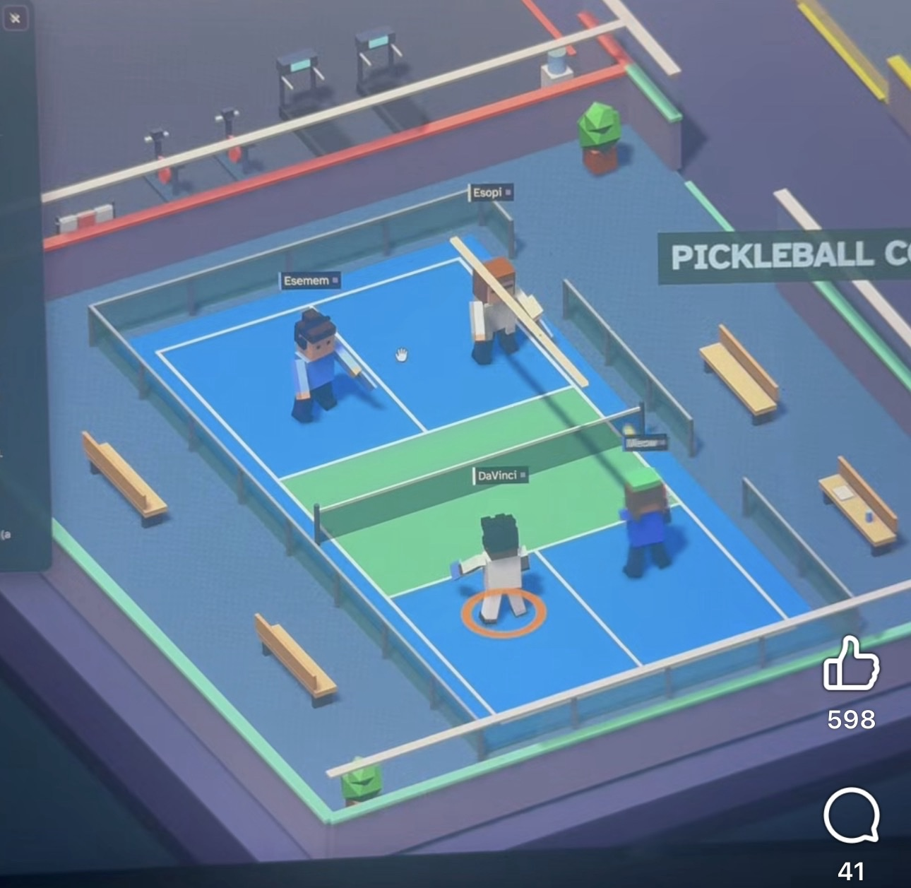

## User Story: Pickleball under Entertainment

**As a** user of the web app,
**I want** a Pickleball page under the Entertainment menu that shows four players playing a doubles rally on a court I can zoom,
**So that** I can watch a real game animation, not a still picture.

**Image reference:**

The page follows that picture: an angled overhead view of a blue court, a green kitchen, a net, four blocky players with paddles, a white ball in the air, benches, a low fence, two plants, and a **PICKLEBALL COURT** sign. The likes, comments, and other social-app chrome in the photo are not part of the page.

---

### Scope

1. Add a child menu named **Pickleball** inside the existing **Entertainment** menu, directly under **Music**.
2. Create a **Pickleball** page at `/entertainment/pickleball`.
3. Show a looping doubles match: the players move, swing, and hit the ball back and forth over the net.
4. Let the user zoom in and zoom out on that court.

This is a static React app. The match is drawn in the browser. There is no backend, account, or multiplayer.

The user watches. The user does not control a player.

---

### Sidebar

| Order | Menu          | Type            | Icon (suggested) | Route                         |
|-------|---------------|-----------------|------------------|-------------------------------|
| 3     | Entertainment | Parent (expand) | Clapperboard     | —                             |
| 3.1   | Music         | Child           | Music note       | `/entertainment/music`        |
| 3.2   | Pickleball    | Child           | CircleDot        | `/entertainment/pickleball`   |

Use the existing icon library (Lucide). Entertainment and Music already exist; add Pickleball as the second child. Leave every other menu item unchanged.

---

### Acceptance Criteria

#### Sidebar — Pickleball

- [ ] **Pickleball** appears indented under **Entertainment**, directly below **Music**, with a CircleDot icon before the label.
- [ ] Clicking **Pickleball** opens `/entertainment/pickleball`.
- [ ] When the Pickleball page is active, **Entertainment** stays expanded and **Pickleball** is highlighted as active.
- [ ] The header title on that route is **Pickleball**.
- [ ] The icon matches the other menu icons: same library, hover behavior, active color, and light and dark mode.
- [ ] The route works on GitHub Pages with the app's existing router setup.

#### Court scene

The scene fills the page body and matches the image reference.

- [ ] The camera is an angled overhead view, with the court centered.
- [ ] The court is blue with white lines: baselines, sidelines, centerline, and service boxes.
- [ ] A green kitchen (non-volley zone) runs along both sides of the net.
- [ ] A net crosses the middle of the court. Players never pass through it.
- [ ] Wooden benches sit along the sides. A low fence surrounds the court. Two green plants stand by the fence. A sign on the right reads **PICKLEBALL COURT**.
- [ ] Four blocky players stand in doubles formation, two on each side of the net. Each has a paddle and a name label that follows them:

| Player  | Side of the net | Outfit                                      | Ready spot        |
|---------|-----------------|---------------------------------------------|-------------------|
| Esemem  | Far             | Dark hair in a bun, blue shirt, dark pants  | Far left          |
| Esopi   | Far             | Brown hair, white shirt, dark pants         | Far right         |
| DaVinci | Near            | Dark hair, white shirt, dark pants          | Near left-center  |
| Fern    | Near            | Green hair, blue shirt, dark pants          | Near right        |

- [ ] Far team is Esemem and Esopi. Near team is DaVinci and Fern.
- [ ] A small ring marks the player who is about to hit, the way the orange ring sits at a player's feet in the reference.
- [ ] The page shell uses the existing light and dark theme tokens. The court keeps the reference colors in both themes so the blue court and green kitchen stay readable.
- [ ] The layout works on desktop, tablet, and mobile. On a narrow screen the court scales down to fit, and the zoom controls stay on screen.

#### Players playing

The match is a repeating rally. Players step toward the ball, swing the paddle, and send the ball to the other side. Waiting players shift their weight. The ball is a small white sphere with a shadow on the court so its height is visible. It arcs, crosses the net, and bounces inside the opposite court.

One rally, then a short reset, then the next rally:

1. **Serve.** Esopi stands behind the far baseline and swings. The ball arcs over the net and bounces in the near right service box.
2. **Return.** Fern steps to the bounce and hits cross-court. The ball bounces on the far side.
3. **Approach.** Esemem moves to the ball and hits it back. Both teams step up toward the kitchen line.
4. **Dinks.** The ball crosses the net twice as a short, low shot. The hitter stays behind the kitchen line until the ball has bounced, then may step in to play it.
5. **Point.** DaVinci hits a deeper ball past Esopi. Esopi moves toward it and does not reach it. The ball bounces twice. The rally ends.
6. **Reset.** All four players walk back to their ready spots. The near score increases by one. The next rally starts, with Fern serving from the near baseline to the far right service box, and the same kind of exchange continuing until the far team wins the point.

- [ ] The loop never stops on its own. After each point the score changes and a new rally starts.
- [ ] A small scoreboard shows the two teams and the score, starting at **0–0**. It stays readable over the scene.
- [ ] Only the player who is hitting swings. The paddle returns to a ready pose after the swing.
- [ ] Feet stay on that player's side of the court during the point.
- [ ] The serve starts from behind the baseline and lands in the diagonal service box.
- [ ] Rally timing, player positions, the hitter, and the score live in plain functions of elapsed time so they can be unit tested without drawing the court.
- [ ] The animation runs only while the Pickleball page is open. Leaving the route stops it.
- [ ] With reduced motion, the page shows the ready court, the four players, and the ball at rest above the center, and it does not play the rally.

#### Zoom

- [ ] **Zoom in**, **Zoom out**, and **Reset** are icon buttons with accessible names, placed over the court.
- [ ] The default view matches the reference framing: the full court, benches, fence, plants, and sign are visible.
- [ ] **Zoom in** moves the camera closer. Players, paddles, the ball, the net, and the kitchen stay recognizable.
- [ ] **Zoom out** moves the camera back and shows more of the floor around the fence.
- [ ] The court stays centered while zooming.
- [ ] Zoom stops at a near limit and a far limit. The button that would pass that limit is disabled.
- [ ] **Reset** returns to the default view.
- [ ] The pointer wheel over the court zooms in and out between the same limits. On a touch screen, a pinch does the same.
- [ ] Keyboard **+** zooms in and **−** zooms out while the page is open, unless the user is typing in another control.
- [ ] Zoom does not restart the rally or move the players. It only changes the camera.

---

### Out of Scope

- Controlling a player, or playing against the computer
- A second court, singles, or more than four players
- Sound
- Accounts, saved matches, or online play
- Copying the social-app likes, comments, or frame from the reference photo

---

### Definition of Done

- [ ] **Pickleball** is under **Entertainment** and `/entertainment/pickleball` renders inside the existing shell.
- [ ] The court matches the image reference: angled overhead view, blue court, green kitchen, net, four named players, benches, fence, plants, and the court sign.
- [ ] The players move, swing, and keep a doubles rally going, and the score changes when a point ends.
- [ ] Zoom in, zoom out, reset, wheel, and pinch change only the camera, and they stop at the near and far limits.
- [ ] Unit tests cover serve placement, the hitter through one rally, the score after a point, and the zoom limits.
- [ ] Light mode, dark mode, reduced motion, and a narrow viewport were checked on the Pickleball page.
- [ ] Music and the other existing routes still behave as before.
